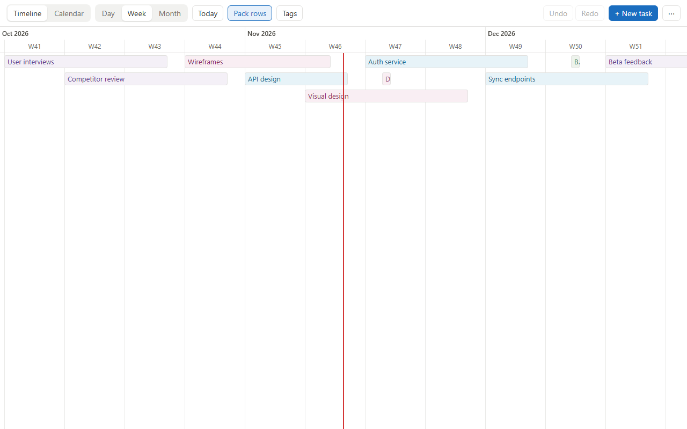
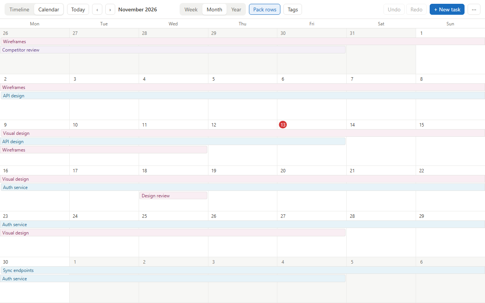

# Timeline Calendar

A local-first roadmap planner. Put tasks on a horizontal timeline or a
calendar, tag them, and drag them around. There is no account and no server:
your data stays in your browser.



## Features

- **Timeline** with Day, Week (ISO week numbers) and Month zoom. It scrolls
  sideways without end.
- **Calendar** with Week, Month and Year views.
- **Tasks** have a title, details, whole-day start and end dates, and tags.
- **Tags** work like Notion: type to filter, press Enter to create. Each tag
  has a colour.
- **Pack rows**: tasks that don't overlap share a row. You can turn it off.
- Create a task by dragging on the timeline or calendar, or with **+ New task**.
- Drag a task to move it. Drag its edges to change its dates.
- Tag filter, tag manager, undo and redo.
- Export and import the roadmap as a JSON file.
- Saves automatically in the browser.

| Calendar (Month)                                       | Task dialog                                 |
| ------------------------------------------------------ | ------------------------------------------- |
|  |  |

## Quick start

You need Node.js 22 or newer.

```bash
npm install
npm run dev   # http://localhost:5173
```

Or run the built app with Docker:

```bash
docker compose up --build   # http://localhost:8080
```

## Where is my data?

In your browser's local storage. It is saved a moment after each change and
when you close the page.

> **Each browser and each address has its own storage.**
> `http://localhost:5173` and `http://localhost:8080` don't share data, and
> neither do Chrome and Firefox. Clearing site data deletes your roadmap.

Use **Export JSON** (the `⋯` menu) to back up or move your roadmap, and
**Import JSON** to load it. Export regularly.

Edit in one tab at a time: two open tabs overwrite each other's changes, so a
tab warns you to reload when the roadmap was changed in another one.

If the saved data can't be read, the app keeps a backup copy, starts empty and
shows a banner with a download link. It never throws your data away silently.

## Keyboard shortcuts

Shortcuts are ignored while you type in a field.

| Key                      | Action                                                  |
| ------------------------ | ------------------------------------------------------- |
| `N`                      | New task                                                |
| `T`                      | Go to today                                             |
| `1` / `2` / `3`          | Timeline zoom Day / Week / Month                        |
| `Ctrl+Z`                 | Undo                                                    |
| `Ctrl+Shift+Z`, `Ctrl+Y` | Redo                                                    |
| `Delete` / `Backspace`   | Delete the selected task                                |
| `Esc`                    | Close popover or dialog, cancel a drag, clear selection |

On macOS, use `⌘` instead of `Ctrl`.

## Scripts

| Command             | What it does                            |
| ------------------- | --------------------------------------- |
| `npm run dev`       | Dev server at http://localhost:5173     |
| `npm run build`     | Type-check and build into `dist/`       |
| `npm run preview`   | Serve `dist/` at http://localhost:4173  |
| `npm test`          | Unit tests (Vitest, watch mode)         |
| `npm run e2e`       | End-to-end tests (Playwright, Chromium) |
| `npm run lint`      | ESLint                                  |
| `npm run typecheck` | TypeScript                              |
| `npm run format`    | Prettier                                |

## Roadmap

- Vertical timeline
- Desktop app (Tauri) that saves to a file
- Export to image
- Themes, including dark mode
- Multiple roadmaps

## Documentation

- [Product specification](docs/SPEC.md)
- [Architecture](docs/ARCHITECTURE.md)
- [Contributing](CONTRIBUTING.md)
- [Changelog](CHANGELOG.md)

## License

MIT. See [LICENSE](LICENSE).
