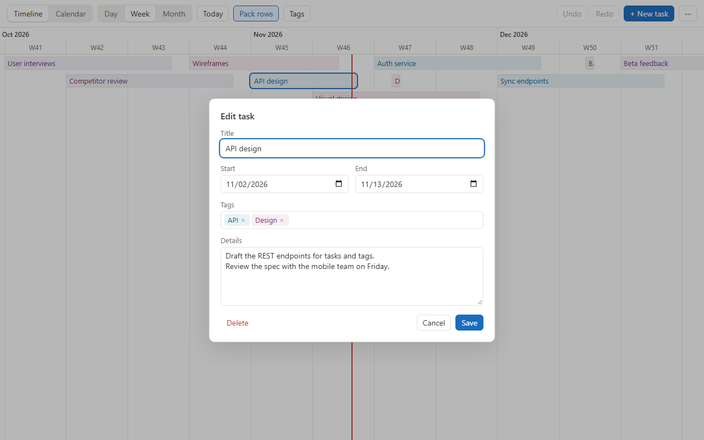

# Simple Timeline Calendar

A local-first roadmap planner. Put tasks on a horizontal timeline or a
calendar, tag them, and drag them around. Host it on a local machine or server
and access it from any browser or device on your network.


## Features

- **Timeline** with Day, Week (ISO week numbers) and Month zoom. It scrolls
  sideways without end.
- **Calendar** with Week, Month and Year views.
- **Tasks** have a title, details, whole-day start and end dates, and tags.
- **Tags** work like Notion: type to filter, press Enter to create. Each tag
  has a colour.
- **Pack rows**: non-overlapping tasks share a row, grouped by primary tag
  (**Dedicated lines per tag** or **Tag-first compact packing**). You can turn
  it off.
- **Today's tasks** side panel (`A`): lists every task scheduled today with
  dates, tags and full details, honouring the tag filter.
- Create a task by clicking or dragging on the timeline or calendar, or with
  **+ New task**. Drag a task to move it, or drag its edges to change its dates.
  **Mouse & drag** settings let you toggle click-to-create or switch dragging to
  pan/scroll or off.
- Tag filter, tag manager (add, rename, recolour, drag-to-reorder and delete),
  undo and redo.
- Export and import the roadmap as **JSON** or **iCalendar (`.ics`)** (with
  date-range and tag filters on export, and **Add** or **Replace** on import).
- Saves automatically on the server (`data/roadmap.json`).

| Calendar (Month)                                       | Task dialog                                 |
| ------------------------------------------------------ | ------------------------------------------- |
|  |  |

## Quick start

You need Node.js 22 or newer.

```bash
npm install
npm run dev   # http://localhost:5173
```

Or run the built app and API server:

```bash
npm run build
npm start                   # http://localhost:8080
```

Or run it with Docker (persists data in `./data`):

```bash
docker compose up --build   # http://localhost:8080
```

## Where is my data?

Tasks and tags are stored on the server as JSON in `data/roadmap.json`
(configurable with `DATA_DIR`; mounted at `./data:/app/data` in Docker), so any
browser or machine opening the server URL loads and edits the same roadmap.
Changes are saved automatically 300 ms after an edit and when leaving the page.

View preferences (Timeline vs Calendar, zoom level, Pack rows, Tag display,
Mouse & drag, tag filter, Today's tasks panel) are stored per browser in
`localStorage`.

If someone on another machine or tab saves changes while your page is open,
saving warns you to reload so you don't overwrite their edits.

Use **Export…** (the `⋯` menu) to download your roadmap as JSON (backup) or
`.ics` (for Google Calendar: Settings → Import & export), optionally limited to
a date range and tags. **Import…** takes either format. **Add** (default) merges
it into the roadmap: new tasks are added, a task with a known id (or `.ics` UID)
is updated, and existing tags are kept as they are. **Replace** swaps the whole
roadmap for the file's contents. Either can be undone.

If the saved data on the server can't be read, the server keeps a backup copy in
`data/backups/`, starts empty, and shows a banner with a download link. It
never throws your data away silently.

## Keyboard shortcuts

Shortcuts are ignored while you type in a field.

| Key                      | Action                                                  |
| ------------------------ | ------------------------------------------------------- |
| `N`                      | New task                                                |
| `T`                      | Go to today                                             |
| `A`                      | Toggle Today's tasks panel                              |
| `1` / `2` / `3`          | Timeline zoom Day / Week / Month                        |
| `Ctrl+Z`                 | Undo                                                    |
| `Ctrl+Shift+Z`, `Ctrl+Y` | Redo                                                    |
| `Delete` / `Backspace`   | Delete the selected task                                |
| `Esc`                    | Close popover or dialog, cancel a drag, clear selection |

On macOS, use `⌘` instead of `Ctrl`.

## Scripts

| Command             | What it does                            |
| ------------------- | --------------------------------------- |
| `npm run dev`       | Dev server at http://localhost:5173     |
| `npm run build`     | Type-check and build client + server    |
| `npm start`         | Run built app + API at port 8080        |
| `npm run preview`   | Serve `dist/` + API at port 4173        |
| `npm test`          | Unit tests (Vitest, watch mode)         |
| `npm run e2e`       | End-to-end tests (Playwright, Chromium) |
| `npm run lint`      | ESLint                                  |
| `npm run typecheck` | TypeScript                              |
| `npm run format`    | Prettier                                |

## Roadmap

- Vertical timeline
- Desktop app (Tauri) that saves to a file
- Export to image
- Themes, including dark mode
- Multiple roadmaps

## Documentation

- [Product specification](docs/SPEC.md)
- [Architecture](docs/ARCHITECTURE.md)
- [Contributing](CONTRIBUTING.md)
- [Changelog](CHANGELOG.md)

## License

MIT. See [LICENSE](LICENSE).
